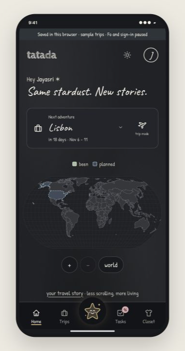
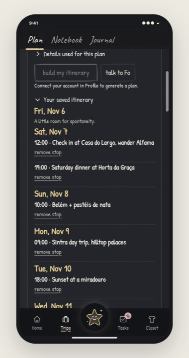
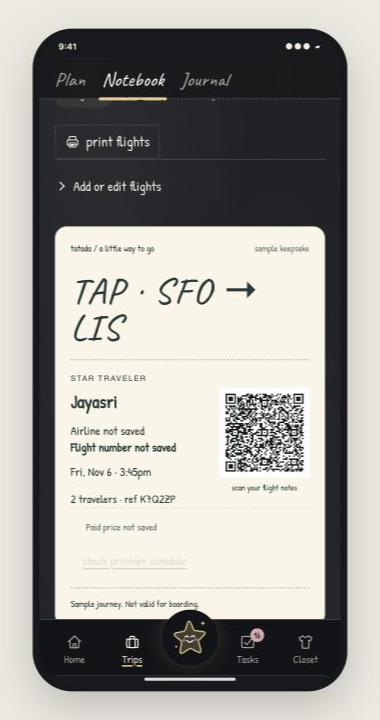
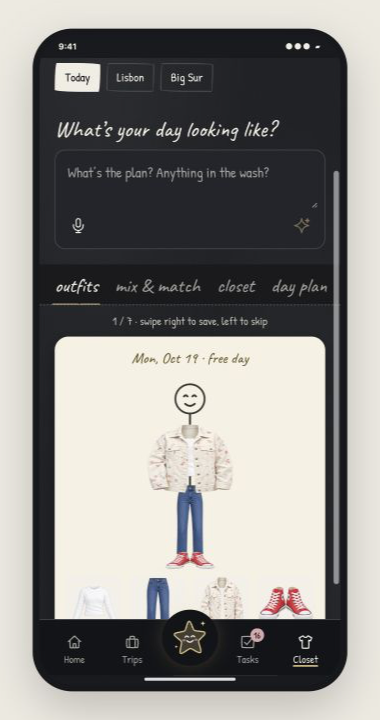
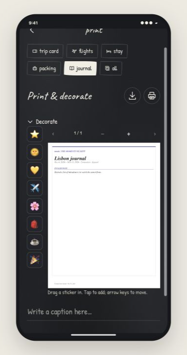

> Current private-beta release and owner instructions: [BETA.md](BETA.md). Automatic one-use invitations support ten testers plus a separate owner. Production promotion remains gated on verified recovery and real Auth checks.

# Tatada ✶

**Pronounced “Ta-tuh-duh”**—the feeling of a little magic falling into place.

**Plan the trip. Put the phone away. Live it.**

## Problem

Travel planning eats the time you wanted to spend traveling. Flights in twenty tab. hotels in another 20. Restaurants in another. Dietary needs, budgets, calendars, packing lists and confirmations scattered everywhere.

Expedia Group’s research found travelers spent **303 minutes researching travel content across the 45 days before booking**. Tatada brings the moving parts of travel into one personal workspace. [Research](https://www.expedia.com/newsroom/eg-path-to-purchase-research/)

## TL;DR

**Your whole trip, from the first “what if?” to the memories you bring home—with less screen time in between.**

When you think “trip,” you think:

1. **Getting there:** flights, transport and confirmations.
2. **Being there:** a place to stay, good food, things to do and a plan that fits you.
3. **Getting ready:** budget, documents, outfits and packing.
4. **Keeping it together:** tasks, calendars, offline essentials and sharing the plan.
5. **Remembering it:** little notes, photos, journals and printed keepsakes.

That is Tatada’s canvas. Bring your details, say what matters and start planning immediately. Fo chat and calls, sourced research and a day-by-day itinerary help turn the pieces into choices you can act on.

### A blackboard for planning. The real world for wonder.

We’re building for **digital detox**: enough time on your phone to get ready, then permission to put it away. Tatada’s chalkboard gives you useful words, choices and logistics instead of an endless feed of destination photos.

**Leave a few surprises unopened.** Know how to get there and what you need, without seeing every view before you arrive. Let the first sight of a place happen when you’re standing in it. Your own photos belong in the journal afterward.

## What we solve

**The ambition: turn four–five hours of trip planning into 20 minutes of decisions.** That is our product target; traveler timing studies are still ahead.

Start with what Tatada already knows: your dates, home airport, budget, interests, food preferences and saved travel details. Speak or type what you want. Build a plan for Sunday, Monday, Tuesday—and every day you’re away.

- **Choose your days.** Review a complete itinerary, compare alternatives for meals and activities, and save your picks together.
- **Find your fit.** Ask for vegetarian restaurants, a slower pace or places near your stay. Source links explain recommendations; ratings and distances appear only when sourced.
- **Choose a flight.** Research route options or check configured fare inventory, then add your choice to the itinerary. A saved option becomes a reservation only after booking with the provider.
- **Talk to Fo.** Chat or call from the app. Fo chat can use your saved trip and food preferences. The current phone connection does not automatically write a call’s choices back into Tatada; the itinerary builder handles reviewed saves today.
- **Carry one plan.** Export chosen stops to Google Calendar, download offline essentials, save confirmations and share a filtered itinerary.
- **Pack and remember.** Plan outfits from your own closet, make a packing list, keep a journal and print the memories.

Open **Trips → choose a trip → Itinerary** to see or build its days, packing and good-to-know notes. New trips open there automatically. For a day trip, choose **plan a day trip**; the SF → Yosemite example includes both drives and a home-by time. Use **something changed** to review a revised remaining plan.

Less searching. Fewer repeated decisions. More time outside.

## Inside Tatada

The app in a phone-sized viewport, shown one screen at a time. These sample trips demonstrate the interface; they are not live bookings.

### Your world



### Your day-by-day itinerary



### Your trip notebook



### Your closet



### Your travel journal



## Connect your accounts

**Fo:** sign in with your own Wajo account. Existing conversations and transcripts remain readable. Tatada v0.1 restricts live free-form Fo execution and calls because the available agent interface cannot enforce an action allowlist. A prompt or approval checkbox is not a provider permission boundary. Separately authorized Gmail and Calendar operations remain available.

**Printing:** configure **Profile → Printing** with your sender preference, Epson address, defaults and ongoing connection consent. Connect the matching Google mailbox with `gmail.send`; a typed sender address never grants permission. Print opens focused settings. Only **Approve & Send** can submit the exact stored PDF, settings, copies, verified sender and destination. Previews, reloads and route links never send. Profile changes invalidate prepared approvals; duplicate keys return the same job and uncertain sends are not replayed. Gmail's response message ID verifies email submission, never physical printing. Wajo conversational receipts are not accepted as Gmail evidence. Copies repeat pages in the PDF; physical paper size remains an Epson setting.

**Google:** configure a Google Cloud Web application OAuth client, enable Gmail and Calendar APIs, and register the exact backend callback. Keep `GOOGLE_CLIENT_ID`, `GOOGLE_CLIENT_SECRET` and `GOOGLE_REDIRECT_URI` private. Add your intended Google account as a test user while the OAuth app is in Testing.

Google connections are separate and optional: Gmail under **Profile → Printing**, Calendar under **Profile → Wajo connection → Optional direct Google connections**. Gmail authorizes PDF print emails. Calendar authorizes app-created calendars with `calendar.app.created`. Review the event preview before adding anything. Calendar exports are one-way copies; Apple Calendar and Outlook can use the `.ics` download.

## Privacy, security and terms

**Keep private things close. Share only what a feature needs.**

- Passport and visa files stay in a **passphrase-encrypted on-device vault**, with separate encrypted backups. Original confirmations also have encrypted device storage.
- Clothing segmentation runs **in your browser** after the model downloads. Offline trip packs keep selected essentials available on the device.
- Connected workspaces also save data on the backend. Google tokens are encrypted server-side; API keys and OAuth secrets stay out of the frontend and Git.
- Itinerary research sends the displayed planning context to Anthropic. Fo requests go to Wajo. Browser dictation may use the browser’s speech service. AI and calls are not entirely on-device.
- You review plans, calendar additions and printing. Trip/account deletion requires confirmation. Exports, external calendar copies and provider records have separate retention.

Read **Terms & conditions** and **Privacy** in the app. AI suggestions need your judgment; prices, availability and opening hours can change. Upload content you have permission to use. Before public launch, operator identity, support/privacy contact and retention periods still need to be finalized.

## Repository

`src/` contains the app; `server/` the private API and integrations; `shared/` shared validation; `supabase/` hosted backend setup; `public/` app assets; `assets/screenshots/` README images; `scripts/` launch/build support.

Private review notes and owner runbooks are ignored and archived locally. Deterministic release tests and CI are tracked; previously committed owner notes remain in earlier Git history.

Map data: [OpenStreetMap / ODbL](https://www.openstreetmap.org/copyright), [Natural Earth](https://www.naturalearthdata.com/about/terms-of-use/). Weather: [Open-Meteo](https://open-meteo.com/).

## Current hosting and running the app

**Tatada supports a hosted public preview and a connected local runtime.** The local preview is `http://127.0.0.1:5180/`; the website is `https://jayasrisng.com/tatada/`, backed by the per-user Supabase adapter. Public users authorize their own Wajo connection. Local owner credentials and sessions are never migrated to visitors. Real-account consent and physical printer output still need to be checked on the hosted runtime.

Use Node 22.22+ and npm. Install dependencies, copy `.env.example` to the ignored `.env`, then supply your own authorized server credentials. `WAJO_FO_API_KEY` is required for the connected personal launcher; `CLAUDE_API_KEY` or `ANTHROPIC_API_KEY` enables research. Google integration additionally needs the OAuth setup above.

```bash
npm ci
cp .env.example .env
# Fill the private .env; never commit it.
TATADA_DEV_PORT=5180 npm run dev:offline
```

The launcher builds the frontend and starts a live backend bound to loopback. Stop the previous launcher before reusing the same port or private data store. `npm run dev` provides frontend hot reload; use the built `dev:offline` preview for cold offline downloads. Keep the computer awake while demonstrating.

```bash
npm run typecheck
npm run build
# Optional browser-only development, without connected backend behavior:
npm run dev:frontend
```

Type checking, the production build, deterministic unit/integration tests and the sample browser suite are available in this repository. Owner runbooks and private evidence stay outside the public snapshot.

**Website deployment is a separate step.** GitHub Pages can serve the frontend; it cannot run the private Node backend or use server secrets. The hosted adapter uses per-user Wajo OAuth. Local API-key mode remains localhost-only. A newly authorized OAuth connection takes precedence over the local key, and disconnect disables the key fallback. The developer launcher also supports `TATADA_WAJO_LOGIN=1 npm run dev` for per-user OAuth without requiring an owner key. The same existing Google OAuth client can be reused with its production callback configured, but local connected sessions are not automatically migrated.

For the retained hosted shape, configure the backend's persistent store, stable sealing secret, public origin and provider secrets; add `https://<project>.supabase.co/functions/v1/tatada-api/api/gmail/callback` to the Google client. Gmail and Calendar share that callback with separate bound state. Keep `http://127.0.0.1:5180/api/gmail/callback` for this local preview. Connect the intended accounts on the hosted runtime and verify its end-to-end behavior before claiming readiness. The email-auth candidate uses permanent verified Supabase identities; Wajo is an optional integration attached to that owner. Existing legacy Wajo workspaces can be linked with their saved one-use recovery key after email and TOTP verification. A typed email never merges workspaces. See the candidate production gates below; the older production API remains unchanged until promotion. Export/import remains a separate data backup; provider credentials are never included.

```bash
# Only after the intended hosted API and account configuration are verified:
VITE_ENABLE_BACKEND=true npm run build:website
```

Publish only the reviewed frontend output. Never publish `.env`, `.data`, private archives, API keys, OAuth tokens, passport files or personal confirmation documents. The hosted build enables the backend explicitly. Automated checks cover recovery and the durable print flow; a real hosted Wajo sign-in and physical printer output remain separate operational checks.

## Release validation

Use Node 22.22+ (CI pins Node 24.19.0). `npm ci`, `npm run typecheck`,
`npm run build`, `npm test`, and `npm run test:e2e` are required release checks.
Install the browser once with `npx playwright install chromium` (Linux CI also
uses `--with-deps`). Unit and backend integration tests can be run separately
with `npm run test:unit` and `npm run test:integration`.

The tracked GitHub Actions **Release validation** job runs these checks on pushes
and pull requests. Repository administrators must require that check in branch
protection and keep deployment gated on it; adding a workflow alone cannot
configure those repository settings. CI does not publish test traces or private logs.

Browser tests use fresh contexts at 1440×900 and 390×844. The default local
server exercises the real sample UI and browser persistence without provider
access. `TATADA_E2E_URL=https://jayasrisng.com/tatada/ npm run test:e2e` exercises
the deployed public sample separately. These checks do not verify live OAuth,
Fo responses, server synchronization or Calendar writes. Live-provider release
validation requires disposable accounts and explicit approval for each external write.

Hosted writers retry acquisition of the shared runtime lease for up to two
seconds before returning `503` with `Retry-After: 2`. Only acquisition is retried;
request handlers and external sends are not replayed. Conflicting workspace
versions return `409` for user review. Reads use committed snapshots. A busy
long-running provider operation can still reject new writes after the wait limit.
Recovery keys do not expire with time: they remain valid until used, replaced,
or the account is deleted. They are stored as hashes, grant workspace access,
and must be kept privately. They do not recover an on-device vault passphrase.

### Release gates and rollback

The release branch must pass typecheck, build, deterministic tests, dependency audit and desktop/mobile Playwright. Browser coverage distinguishes sample journeys and controlled API fixtures from live provider evidence. Real invitation-backed password login and TOTP must pass on two disposable accounts and survive refresh/device changes. Optional Wajo connection must remain attached to the same owner. Legacy workspace linking consumes its existing recovery key once; never merge by typed email.

Before promotion, verify the Google OAuth application's publishing/test-user status and exact redirect URIs, actual Supabase backup availability and a restore drill in an isolated target. Application export or an in-memory repository test does not prove database backups. Keep the existing sealing secret and runtime row unchanged; these changes add optional JSON fields without replacing account IDs or recovery records. Do not deploy while a required gate is unresolved.

Record the previous frontend artifact and edge function bundle before promotion. Promote the compatible backend first, then the matching frontend. During rollback, stop consequential traffic and restore only reviewed compatible artifacts while retaining the runtime row and sealing key; do not restore known unsafe printing behavior. Consumed exchange tombstones are expired so an older server cannot redeem them again. Existing pending sign-ins using the legacy CSRF cookie and browser binding remain supported; prepared jobs require fresh approval after printing-profile changes. Never restore an older database snapshot over production as a code rollback.

## Verified email account migration candidate

The candidate replaces hosted Wajo identity with Supabase verified email OTP. Supabase `auth.users.id` maps to an existing Tatada owner; Wajo becomes an optional connection. Local demo/owner modes are retained for local development. Payments and cloud document sync default to false, with no payment provider or cloud vault implementation.

Apply the additive session-check migration before the candidate API. It grants only `service_role` access to a narrow private helper; it does not grant browsers access to `auth.sessions` or change the runtime row. Every request verifies the access token with Supabase, checks the actual session, and applies app revocation, 14-day idle and 30-day absolute limits. Sensitive routes additionally require a verified TOTP factor and signed MFA authentication within five minutes; merely possessing an AAL2 token with an old authentication timestamp is insufficient.

Existing users first verify email and enroll/verify an authenticator. Under Account security, link the older workspace with its existing one-use recovery key **before creating new work**. Linking is serialized under the hosted database lease, preserves account IDs and all associated data, consumes the key, and records the previous mapping for operator review. There is no email-based merge or automatic reassignment. Conflicting populated workspaces require explicit resolution; do not delete either one to bypass the conflict. Keep exports separately. A lost key or authenticator requires operator-assisted identity checks; the app provides no MFA bypass.

### Consolidated production gates

1. Configure Supabase custom SMTP with a verified sender and production delivery capacity. In the Magic Link email template include `{{ .Token }}` for email OTP rather than a magic-link-only message. Confirm email login/signups as intended, exact production Site URL/redirect allowlist, TOTP enrollment/verification enabled, appropriate OTP/JWT limits and provider session policies. The app requires HTTPS and the platform public key; the service-role key remains server-only.
2. Execute real desktop/mobile and second-device sign-ins with **two disposable email accounts**: invalid/expired OTP, refresh, sign-out and global revocation, authenticator enrollment, invalid/expired TOTP, relock, account isolation, recovery-key migration/replay rejection, unchanged records, and credential ownership. Controlled SDK/HTTP fixtures do not prove SMTP or provider configuration. Never put real OTPs, QR secrets, tokens or recovery keys in test artifacts.
3. Verify actual Supabase backup availability and restore into an isolated project, preserving the sealing secret. Compare record counts and ownership, test the candidate there, and rehearse an application rollback without restoring consumed recovery keys or revoked sessions. A JSON fixture round trip is not a database restore drill. Leave the additive helper in place during application rollback. Do not reopen legacy auth as an automatic fallback.
4. Verify Google OAuth publishing/test-user status and exact hosted callback, send-only sender ownership and account isolation. A real email/physical print requires separate explicit authorization; opening settings or preview cannot deliver. Fo execution remains restricted while provider action scopes cannot be enforced.
5. Finalize operator/support/privacy contact and backup retention. Confirmed account deletion removes active Tatada records and stores a minimal revocation tombstone plus bounded identity-cleanup job. Provider failures retry on later worker runs/requests (up to five attempts); exhausted jobs require operator review. Keep backups and other-device copies under their documented removal process.

Do not merge or deploy the candidate until these gates pass. Prior operational Wajo login evidence does not verify the new email/MFA flow. The current production API remains unchanged until promotion.
